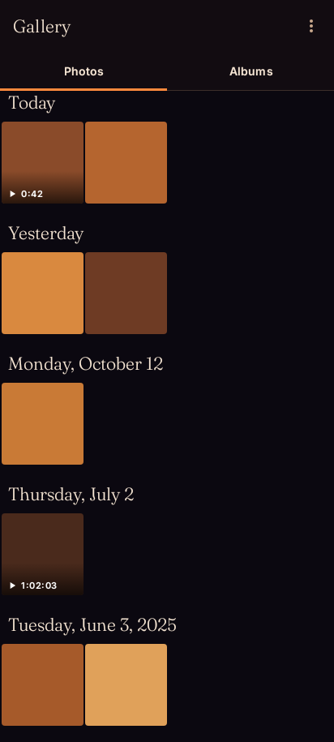
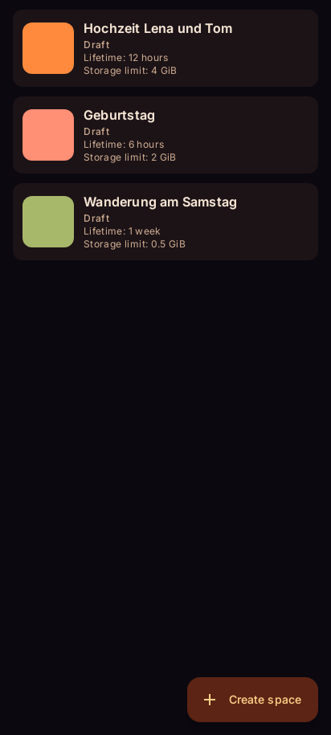
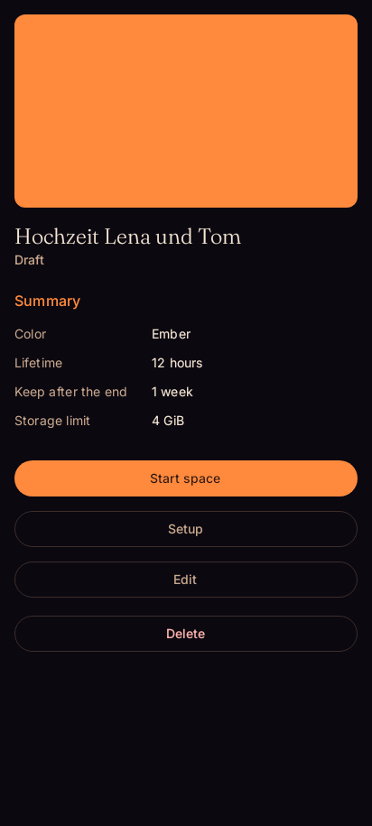
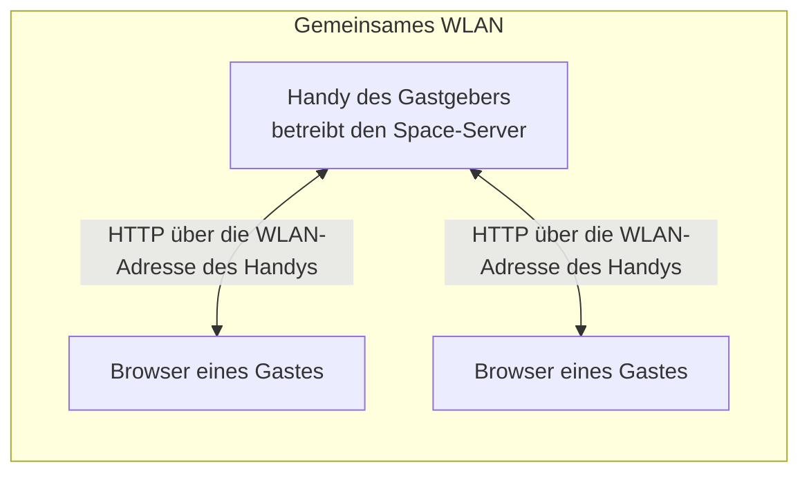

<div align="center">


**Eine private Foto- und Video-Galerie für Veranstaltungen. Dein Handy ist der Server, kein fremder Dienst.**


<p><a href="README.md">English</a> · <strong>Deutsch</strong></p>

</div>

## Worum es geht

Nach einer Feier, einem Turnier oder einem Ausflug hat jeder ein paar Fotos auf dem eigenen Handy, und niemand hat alle. Geteilt wird über Messenger-Gruppen, Cloud-Alben oder gar nicht. emberlight macht das vor Ort, ohne Umweg über fremde Server:

- **Space öffnen.** Auf deinem Handy legst du einen Space an: mit Namen, Titelbild, Farbe und Laufzeit.
- **QR-Code zeigen.** Die Gäste scannen ihn und sind im Browser dabei. Keine App nötig.
- **Teilen.** Alle laden Fotos und Videos hoch und sehen, was die anderen geteilt haben.
- **Vorbei.** Nach dem Ende schließt der Space, und die Medien werden nach der Aufbewahrungsfrist gelöscht. Wer etwas gespeichert hat, behält seine Kopie.

Kein Konto, keine Cloud, keine Plattform. Die Fotos verlassen das lokale Netz nicht.

## Was die App bietet

| Bereich | Stand | Inhalt |
|---|---|---|
| Galerie | stabil ([v0.2.0](https://github.com/Labushuya/emberlight/releases/tag/v0.2.0)) | Zeitleiste, Alben, Pinch-Zoom, Vollbild mit Wischen und Zoom, Videowiedergabe, Infobereich, eigenes dunkles Design |
| Spaces | Vorab-Version ([v0.3.0-alpha.2](https://github.com/Labushuya/emberlight/releases/tag/v0.3.0-alpha.2)) | siehe Liste unten |

Spaces im Einzelnen:

- Space anlegen: Name, Titelbild, Farbe, Laufzeit, Aufbewahrung nach dem Ende, Speicherlimit
- Gäste treten per QR-Code im Browser bei, ohne App, mit einem Anzeigenamen
- Fotos und Videos hochladen (Fortschritt je Datei) und ansehen oder herunterladen
- Standort wird beim Hochladen entfernt. Lässt er sich nicht sicher entfernen, fragt die Seite pro Datei nach
- Laufzeit ansehen und verlängern (höchstens 30 Tage ab Start)
- Gastgeber-Kontrolle: Teilnehmer und Uploads entfernen, Einladung erneuern
- Aufbewahrung nach dem Ende mit Erinnerung und automatischem Löschen
- Vorlagen: ein neuer Space übernimmt Name, Farbe, Titelbild und Einstellungen, ohne Medien

Ohne Google-Play-Dienste. Open Source unter GPL-3.0-or-later.

<p align="center">
  
  
  
</p>

Die Bilder zeigen Demodaten aus den Tests, keine echten Aufnahmen.

## Anwendungsfälle

Überall dort, wo viele Leute Bilder haben und niemand sie auf einer fremden Plattform ablegen möchte:

- **Geburtstag.** Die Gäste laden Fotos vom Buffet, von den Spielen und aus dem Garten hoch. Am nächsten Tag hat jeder die Bilder der anderen, ohne eine Gruppe mit achtzig Leuten.
- **Hochzeit.** Gäste aus verschiedenen Familien und Freundeskreisen teilen ihre Fotos vom Tag. Die Brautleute bestimmen, wie lange der Space läuft und wann er löscht.
- **Turniere und Sportveranstaltungen.** Teams und Eltern am Spielfeldrand teilen Szenen vom Spiel. Die Bilder bleiben auf dem Handy des Veranstalters, nicht auf einer fremden Plattform.
- **Schulfeste und Schulfotos.** Eltern erhalten Bilder vom Fest, ohne dass Kinderfotos auf einem Server landen, dessen Betreiber man nicht kennt.
- **Klassenfahrt, Kita, Vereinsfest, Familientreffen.** Dieselbe Idee in kleinerem Rahmen.

**Datenschutz und Kinderschutz.** Bei Fotos von Kindern und bei intimen Aufnahmen ist entscheidend, wo die Dateien liegen. Bei emberlight liegen sie auf dem Handy des Gastgebers. Es gibt keinen Server, der sie aufbewahrt, keine Plattform, die sie auswertet oder für Werbung nutzt, und sie werden nach der Aufbewahrungszeit automatisch gelöscht.

Ehrlich gesagt: Gäste sehen die Bilder im Browser und können alles, was sie sehen, selbst speichern und weitergeben. emberlight kann das nicht verhindern.

## So funktioniert es

1. **Space anlegen** auf dem Handy des Gastgebers: Name, Laufzeit, Speicherlimit.
2. **Space starten.** Die App öffnet einen Server im WLAN-Netz des Handys und zeigt einen QR-Code.
3. **Gäste scannen den Code** mit der Kamera. Im Browser öffnet sich der Space, dort geben sie einen Anzeigenamen ein.
4. **Gäste teilen.** Fotos und Videos werden hochgeladen, der Standort entfernt. Alle sehen die gemeinsame Ansicht und können herunterladen.
5. **Ende.** Der Space schließt zur festgelegten Zeit. Nach der Aufbewahrungsfrist werden die Medien gelöscht.



## Voraussetzungen und Netzwerk-Tipps

- **Alle im selben WLAN.** Ein Space braucht eine WLAN-Verbindung mit IPv4-Adresse. Mobile Daten allein reichen nicht. Fehlt das WLAN, sagt die App: „Kein WLAN mit IPv4-Adresse verbunden.“
- **Gast- und Firmen-WLANs trennen Geräte oft voneinander.** Dann finden sich die Handys nicht. Am zuverlässigsten ist ein WLAN, dem du vertraust, mit Passwort.
- **VPN und Diensthandys.** Ein VPN auf dem Gast-Handy oder Vorgaben der Firma (MDM) können die Verbindung verhindern. Der Server nimmt nur Anfragen aus dem WLAN an, in dem er läuft.
- **Berechtigung „Lokales Netzwerk“.** Ab Android 17 fragt die App danach. Ohne sie nimmt der Server keine Verbindungen an.
- **Wechsel des Netzes.** Wechselt das WLAN oder dessen Adresse, pausiert der Space. Kommt dasselbe Netz zurück, läuft er weiter. Sonst bestätigst du den neuen Stand, und der QR-Code ändert sich.
- **Akku.** Lass emberlight von der Akkuoptimierung ausnehmen, sonst kann Android den Dienst während der Feier beenden. Die App führt dich dorthin.
- Ein **eigenes WLAN der App** für Orte ohne gemeinsames Netz gibt es noch nicht (geplant).

## Sicherheit und Datenschutz, ehrlich

**Geschützt** (laut Quellcode und Tests des Projekts):

- Der Server hört nur auf die WLAN-Adresse des Gastgeber-Handys, nicht auf alle Netze. Anfragen aus anderen Netzen werden abgewiesen.
- Der Einladungscode steht im Link hinter dem `#`. Browser senden diesen Teil nicht an den Server, und die Seite entfernt ihn nach dem Lesen aus der Adresszeile.
- Jeder Gast hat einen eigenen Zugangsschlüssel. Das Gastgeber-Handy speichert davon nur den SHA-256-Hash.
- Links zu Medien sind signiert und laufen nach 10 bis 30 Minuten ab.
- Falsche Einladungen werden gedrosselt.
- Hochgeladene Dateien erkennt die App am Inhalt, nicht an der Endung. Die Gäste-Seite läuft mit einer strengen Content-Security-Policy, und fremde Webseiten können die Antworten nicht lesen.
- Standortdaten (GPS und Ortsnamen) werden beim Hochladen entfernt. Details und Grenzen: [ADR 0015](docs/adr/0015-entfernung-von-standortdaten.md).

**Grenzen, bitte lesen:**

- **Die Verbindung im WLAN ist unverschlüsseltes HTTP.** Wer im selben WLAN den Datenverkehr mitschneiden kann, sieht Fotos und Zugangsschlüssel. Nutze deshalb nur vertrauenswürdige, passwortgeschützte WLANs.
- Browser können für ein lokales Gerät ohne fremden Server kein vertrauenswürdiges HTTPS anbieten. Eine verschlüsselte Verbindung zwischen zwei Apps ist geplant.
- Der Gastgeber vertraut dem eigenen Gerät. Gäste können gesehene Bilder speichern und weitergeben.
- Der Standort lässt sich nicht bei jedem Dateiformat sicher entfernen. Dann lehnt die App den Upload ab oder fragt pro Datei nach. Bekannte Restrisiken stehen in [ADR 0015](docs/adr/0015-entfernung-von-standortdaten.md).
- Die Aussagen oben beschreiben Entwurf und Tests dieses Projekts. Sie sind keine Garantie.

## Stand und Ausblick

- **Meilenstein 1, Grundgerüst:** abgeschlossen mit [v0.1.0](https://github.com/Labushuya/emberlight/releases/tag/v0.1.0).
- **Meilenstein 2, Galerie:** stabil mit [v0.2.0](https://github.com/Labushuya/emberlight/releases/tag/v0.2.0).
- **Meilenstein 3, Spaces im vorhandenen WLAN:** Vorab-Version [v0.3.0-alpha.2](https://github.com/Labushuya/emberlight/releases/tag/v0.3.0-alpha.2), zum Testen gedacht. Der Plan steht in [docs/PLAN-M3.md](docs/PLAN-M3.md).
- **Als Nächstes:** Übernahme ausgewählter Medien in die Galerie (Paket 3.7), danach Version 0.3.0.
- **Geplant, ohne Termin:** verschlüsselte Verbindung zwischen zwei Apps, Beitritt direkt in der App, eigenes WLAN der App.

## Installation

1. Aus den [Releases](https://github.com/Labushuya/emberlight/releases) die APK und die zugehörige `.sha256`-Datei laden.
2. Die Prüfsumme vergleichen: `sha256sum -c emberlight-vX.Y.Z.apk.sha256` (Linux, macOS, Git Bash) oder `certutil -hashfile emberlight-vX.Y.Z.apk SHA256` (Windows) mit dem Wert in den Release-Notes.
3. Das Signaturzertifikat prüfen: `apksigner verify --print-certs emberlight-vX.Y.Z.apk` aus den Android-Build-Tools. Der SHA-256-Digest muss `633d1c795eb14f06d02b3e985baf4b0d0e8a34b1d2471928fa2e060e93bd1e36` sein.
4. Auf dem Gerät öffnen. Android erlaubt die Installation aus unbekannten Quellen dafür einmalig.

Voraussetzung ist Android 8.0 oder neuer.

**Vorab-Versionen:** Die aktuelle ist `v0.3.0-alpha.2`. Bitte **`v0.3.0-alpha.1` nicht mehr verwenden**. Dort blieb bei manchen Kamerafotos (zum Beispiel von Honor-Handys) der Standort erhalten. Das ist in alpha.2 behoben. Ein Update von alpha.1 auf alpha.2 ist möglich, die Datenbank wird übernommen. Ein Rückschritt auf eine ältere Version geht nur per Deinstallation, dabei gehen die Space-Daten verloren.

## Aus dem Quellcode bauen

Voraussetzungen: JDK 17 für Gradle und den Build, Android SDK mit API 37. JDK 21 für die Unit-Tests lädt Gradle automatisch.

```sh
./gradlew check                 # Lint, ktlint, Unit-Tests, Screenshot-Prüfung, Coverage, Prüfung auf Play Services
./gradlew assembleDebug         # Debug-APK
./gradlew assembleRelease -Pemberlight.version=0.2.0   # Release-APK, Version ohne Property: 0.0.0-dev
```

Signierte Release-APKs brauchen eigene Schlüssel, die nie im Repository liegen. Die Anleitung steht in [docs/RELEASE.md](docs/RELEASE.md).

## Dokumentation

- [Konzept und Entscheidungen](docs/KONZEPT.md)
- [Architekturentscheidungen (ADR)](docs/adr/)
- [Hinweise für die Entwicklung mit Claude Code](CLAUDE.md)
- [Sicherheitsrichtlinie](SECURITY.md)

## Lizenz

emberlight ist freie Software unter der **GNU General Public License, Version 3 oder später** (SPDX: `GPL-3.0-or-later`). Der Lizenztext steht in [LICENSE](LICENSE). Copyright (C) 2026 Labushuya.

## Drittanbieter

**Bibliotheken.** emberlight nutzt Bibliotheken anderer Projekte, unter anderem AndroidX, Jetpack Compose, Kotlin, Coil, Media3, Ktor, Room, Hilt, Telephoto, kotlinx und ZXing (QR-Codes, `com.google.zxing:core`, Version 3.5.4). Sie stehen unter der [Apache License 2.0](https://www.apache.org/licenses/LICENSE-2.0). ZXing: [Lizenz](https://github.com/zxing/zxing/blob/master/LICENSE). Die vollständige Liste mit Lizenzhinweisen steht in der App unter „Über & Lizenzen“ (Galerie, Überlaufmenü, drei Punkte). Sie entsteht beim Build mit [AboutLibraries](https://github.com/mikepenz/AboutLibraries) (Apache-2.0). Die Entscheidung steht in [ADR 0020](docs/adr/0020-lizenzhinweise-in-der-app.md).

**Schriften.** Die App liefert Fraunces (Titel) und Inter (Text) mit, beide unter der [SIL Open Font License 1.1](https://openfontlicense.org/). Die Lizenztexte liegen unter [`core/design/src/main/assets/licenses`](core/design/src/main/assets/licenses). Die Schriftdateien sind unverändert übernommen.

Die Schriften liegen als eigenständige Dateien neben dem Programmcode, sie sind kein Teil des GPL-Codes. Diese Einordnung ist eine Auskunft des Projekts und keine Rechtsberatung.
