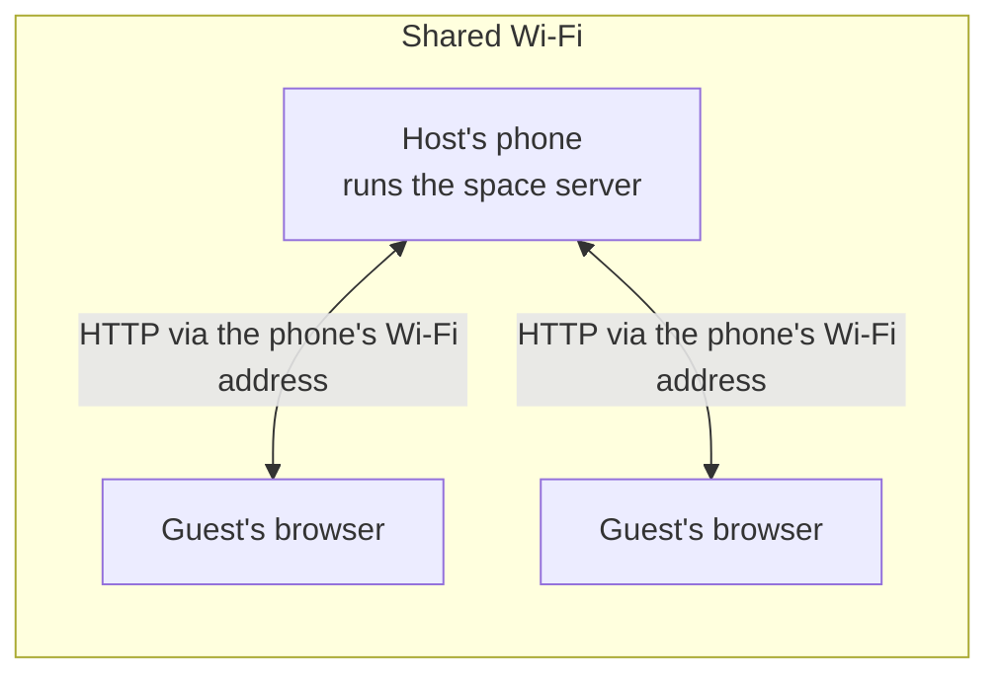

<div align="center">


**A private photo and video gallery for events. Your phone is the server, not someone else's service.**


<p><strong>English</strong> · <a href="README.de.md">Deutsch</a></p>

</div>

## What is emberlight?

After a party, a tournament or a trip, everyone has a few photos on their own phone, and nobody has all of them. They get shared through group chats, cloud albums, or not at all. emberlight solves this on site, without a detour through someone else's server:

- **Open a space.** On your phone you create a space with a name, a cover image, a colour and a lifetime.
- **Show the QR code.** Guests scan it and join in their browser. No app needed.
- **Share.** Everyone uploads photos and videos and sees what the others shared.
- **Done.** When the time is up, the space closes, and the media are deleted after the retention period. Anyone who saved something keeps their copy.

No account, no cloud, no platform. The photos never leave the local network.

## What the app offers

| Area | Status | Contents |
|---|---|---|
| Gallery | stable ([v0.2.0](https://github.com/Labushuya/emberlight/releases/tag/v0.2.0)) | Timeline, albums, pinch to zoom, full screen with swipe and zoom, video playback, info panel, own dark design |
| Spaces | pre-release ([v0.3.0-alpha.2](https://github.com/Labushuya/emberlight/releases/tag/v0.3.0-alpha.2)) | see the list below |

Spaces in detail:

- Create a space: name, cover image, colour, lifetime, retention after the end, storage limit
- Guests join through the QR code in their browser, without an app, with a display name
- Upload photos and videos (progress per file), view them and download them
- Location data is removed on upload. If it cannot be removed safely, the guest page asks per file
- Check the remaining time and extend it (up to 30 days from the start)
- Host controls: remove participants and uploads, renew the invitation
- Retention after the end with reminders, then automatic deletion
- Templates: a new space takes over name, colour, cover image and settings, without media

No Google Play services. Open source under GPL-3.0-or-later.

<p align="center">
  
  
  
</p>

The images show demo data from the tests, not real photos.

## Use cases

Anywhere many people have pictures and nobody wants to put them on a stranger's platform:

- **Birthday.** Guests upload photos from the buffet, the games and the garden. The next day everyone has everyone else's pictures, without a group chat of eighty people.
- **Wedding.** Guests from different families and circles of friends share their photos of the day. The couple decides how long the space runs and when it deletes.
- **Tournaments and sports events.** Teams and parents on the sidelines share moments from the match. The pictures stay on the organiser's phone, not on a third-party platform.
- **School parties and school photos.** Parents get pictures from the event without children's photos ending up on a server whose operator nobody knows.
- **School trip, daycare, club event, family reunion.** The same idea on a smaller scale.

**Privacy and child protection.** With photos of children or intimate pictures, what matters is where the files end up. With emberlight they stay on the host's phone. There is no server keeping them, no platform analysing them or using them for advertising, and they are deleted automatically after the retention period.

To be honest: guests see the pictures in their browser and can save and pass on anything they see. emberlight cannot prevent that.

## How it works

1. **Create a space** on the host's phone: name, lifetime, storage limit.
2. **Start the space.** The app opens a server on the phone's Wi-Fi network and shows a QR code.
3. **Guests scan the code** with their camera. The space opens in their browser, where they enter a display name.
4. **Guests share.** Photos and videos are uploaded and location data is removed. Everyone sees the shared view and can download.
5. **End.** The space closes at the set time. After the retention period the media are deleted.



## Requirements and network tips

- **Everyone on the same Wi-Fi.** A space needs a Wi-Fi connection with an IPv4 address. Mobile data alone is not enough. Without Wi-Fi the app says: "No Wi-Fi with an IPv4 address."
- **Guest and company Wi-Fi often keep devices apart.** Then the phones cannot find each other. The most reliable choice is a Wi-Fi you trust, with a password.
- **VPN and work phones.** A VPN on the guest's phone, or company policies (MDM), can prevent the connection. The server only accepts requests from the Wi-Fi network it runs on.
- **"Local network" permission.** From Android 17 on, the app asks for it. Without it the server accepts no connections.
- **Network changes.** If the Wi-Fi or its address changes, the space pauses. If the same network comes back, it continues. Otherwise you confirm the new state, and the QR code changes.
- **Battery.** Exclude emberlight from battery optimisation, otherwise Android may stop the service during the event. The app guides you there.
- An **own Wi-Fi of the app** for places without a shared network does not exist yet (planned).

## Security and privacy, honestly

**Protected** (according to the source code and the tests of the project):

- The server listens only on the Wi-Fi address of the host's phone, not on all networks. Requests from other networks are refused.
- The invitation code sits in the link after the `#`. Browsers do not send this part to the server, and the page removes it from the address bar after reading it.
- Each guest has their own access key. The host's phone stores only the SHA-256 hash of each key.
- Media links are signed and expire after 10 to 30 minutes.
- Wrong invitation attempts are rate limited.
- The app recognises uploaded files by their content, not by their file extension. The guest page runs under a strict Content Security Policy, and foreign web pages cannot read the responses.
- Location data (GPS and place names) is removed on upload. Details and limits: [ADR 0015](docs/adr/0015-entfernung-von-standortdaten.md).

**Limits, please read:**

- **The connection inside the Wi-Fi is unencrypted HTTP.** Anyone on the same Wi-Fi who can capture the traffic sees photos and access keys. Only use trusted, password-protected Wi-Fi networks.
- Browsers cannot offer trusted HTTPS for a local device without a server of someone else. An encrypted connection between two apps is planned.
- The host trusts their own device. Guests can save and pass on pictures they see.
- Location data cannot be removed safely for every file format. In that case the app refuses the upload or asks per file. Known residual risks are described in [ADR 0015](docs/adr/0015-entfernung-von-standortdaten.md).
- The statements above describe the design and tests of this project. They are not a guarantee.

## Status and outlook

- **Milestone 1, foundation:** completed with [v0.1.0](https://github.com/Labushuya/emberlight/releases/tag/v0.1.0).
- **Milestone 2, gallery:** stable with [v0.2.0](https://github.com/Labushuya/emberlight/releases/tag/v0.2.0).
- **Milestone 3, spaces in an existing Wi-Fi:** pre-release [v0.3.0-alpha.2](https://github.com/Labushuya/emberlight/releases/tag/v0.3.0-alpha.2), meant for testing. The plan is in [docs/PLAN-M3.md](docs/PLAN-M3.md).
- **Next:** taking selected media into the gallery (package 3.7), then version 0.3.0.
- **Planned, no date set:** encrypted connection between two apps, joining directly in the app, an own Wi-Fi for the app.

## Installation

1. Download the APK and its `.sha256` file from the [Releases](https://github.com/Labushuya/emberlight/releases).
2. Compare the checksum: `sha256sum -c emberlight-vX.Y.Z.apk.sha256` (Linux, macOS, Git Bash) or `certutil -hashfile emberlight-vX.Y.Z.apk SHA256` (Windows) with the value in the release notes.
3. Check the signing certificate: `apksigner verify --print-certs emberlight-vX.Y.Z.apk` from the Android build tools. The SHA-256 digest must be `633d1c795eb14f06d02b3e985baf4b0d0e8a34b1d2471928fa2e060e93bd1e36`.
4. Open the file on the device. Android asks once for permission to install from unknown sources.

Requires Android 8.0 or newer.

**Pre-releases:** the current one is `v0.3.0-alpha.2`. Please **do not use `v0.3.0-alpha.1` any more**. In that version, location data stayed in some camera photos (for example from Honor phones). This is fixed in alpha.2. An update from alpha.1 to alpha.2 is possible, the database is migrated. Going back to an older version works only by uninstalling, and the space data is lost.

## Build from source

Requirements: JDK 17 for Gradle and the build, Android SDK with API 37. Gradle downloads JDK 21 for the unit tests automatically.

```sh
./gradlew check                 # lint, ktlint, unit tests, screenshot verification, coverage, Play services check
./gradlew assembleDebug         # debug APK
./gradlew assembleRelease -Pemberlight.version=0.2.0   # release APK, without the property: 0.0.0-dev
```

Signed release APKs need their own keys, which never live in the repository. See [docs/RELEASE.md](docs/RELEASE.md).

## Documentation

- [Concept and decisions](docs/KONZEPT.md) (German)
- [Architecture decision records (ADR)](docs/adr/) (German)
- [Notes for development with Claude Code](CLAUDE.md) (German)
- [Security policy](SECURITY.md)

## License

emberlight is free software under the **GNU General Public License, version 3 or later** (SPDX: `GPL-3.0-or-later`). The licence text is in [LICENSE](LICENSE). Copyright (C) 2026 Labushuya.

## Third-party software

**Libraries.** emberlight uses libraries from other projects, including AndroidX, Jetpack Compose, Kotlin, Coil, Media3, Ktor, Room, Hilt, Telephoto, kotlinx and ZXing (QR codes, `com.google.zxing:core`, version 3.5.4). They are licensed under the [Apache License 2.0](https://www.apache.org/licenses/LICENSE-2.0). ZXing: [licence](https://github.com/zxing/zxing/blob/master/LICENSE). The complete list with licence notices is in the app under "About & licenses" (gallery, overflow menu, three dots). It is generated at build time with [AboutLibraries](https://github.com/mikepenz/AboutLibraries) (Apache-2.0). The decision is in [ADR 0020](docs/adr/0020-lizenzhinweise-in-der-app.md) (German).

**Fonts.** The app ships Fraunces (titles) and Inter (text), both under the [SIL Open Font License 1.1](https://openfontlicense.org/). The licence texts are in [`core/design/src/main/assets/licenses`](core/design/src/main/assets/licenses). The font files are included unchanged.

The fonts are standalone files next to the program code, they are not part of the GPL code. This classification is the project's own statement and not legal advice.
