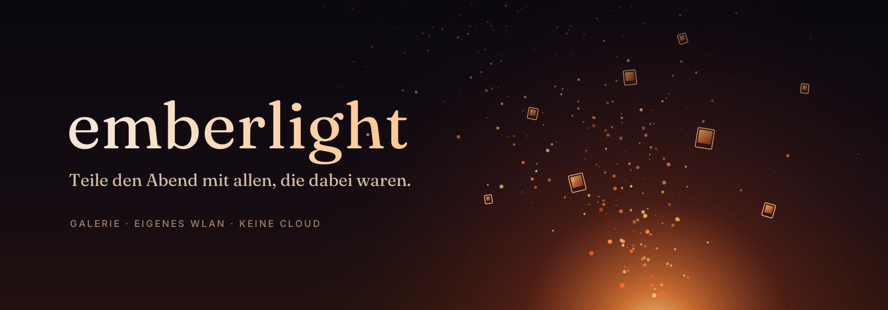

**Eine Galerie für deine Fotos und Videos. Und ein eigenes WLAN, über das alle, die gerade dabei sind, ihre Bilder teilen.**

## Was ist emberlight?

Nach einer Feier, einem Urlaub oder einem Abend mit Freunden liegen die Fotos auf zehn Handys verteilt. Geteilt
wird dann über WhatsApp-Gruppen, Cloud-Alben oder gar nicht. emberlight löst das vor Ort:

- **Space öffnen.** Du gibst ihm einen Namen, ein Titelbild, eine Farbe und eine Laufzeit, zum Beispiel „bis 2 Uhr nachts“.
- **QR-Code zeigen.** Wer ihn scannt, ist im Space. Gibt es kein gemeinsames WLAN, spannt emberlight ein eigenes auf.
- **Teilen.** Alle laden Fotos und Videos hoch und holen sich, was sie wollen. Gäste brauchen dafür keine App, der Browser reicht.
- **Vorbei.** Läuft die Zeit ab, schließt der Space. Jeder behält seine Kopien, nichts liegt auf fremden Servern.

Dazu kommt eine Galerie, die so schön und flüssig sein soll wie möglich.

| | |
|---|---|
| Galerie | Zeitleiste, Alben, flüssiger Zoom, Videos, eigene Themes |
| Sharing-Space | Zeitlich begrenzt, Rechte pro Space, Gäste per QR-Code |
| Netzwerk | Vorhandenes WLAN oder eigenes WLAN der App, kein Internet nötig |
| Datenschutz | Keine Konten, keine Cloud, kein Tracking |

## Dokumentation

- [Konzept und Entscheidungen](docs/KONZEPT.md)
- [Hinweise für die Entwicklung mit Claude Code](CLAUDE.md)

## Rechte

Copyright (c) 2026 Labushuya. Alle Rechte vorbehalten. Siehe [LICENSE](LICENSE).
